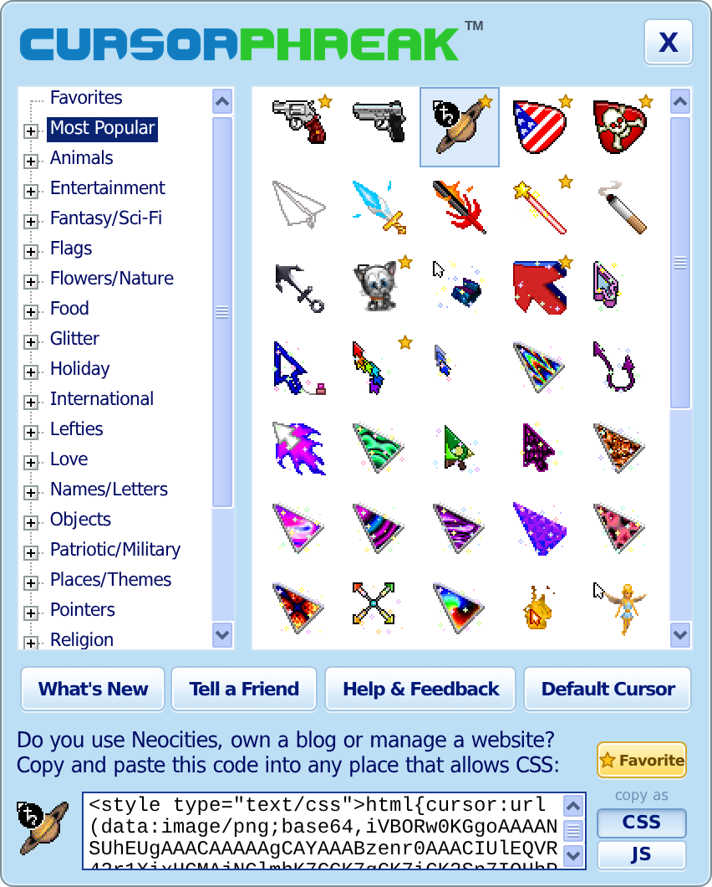
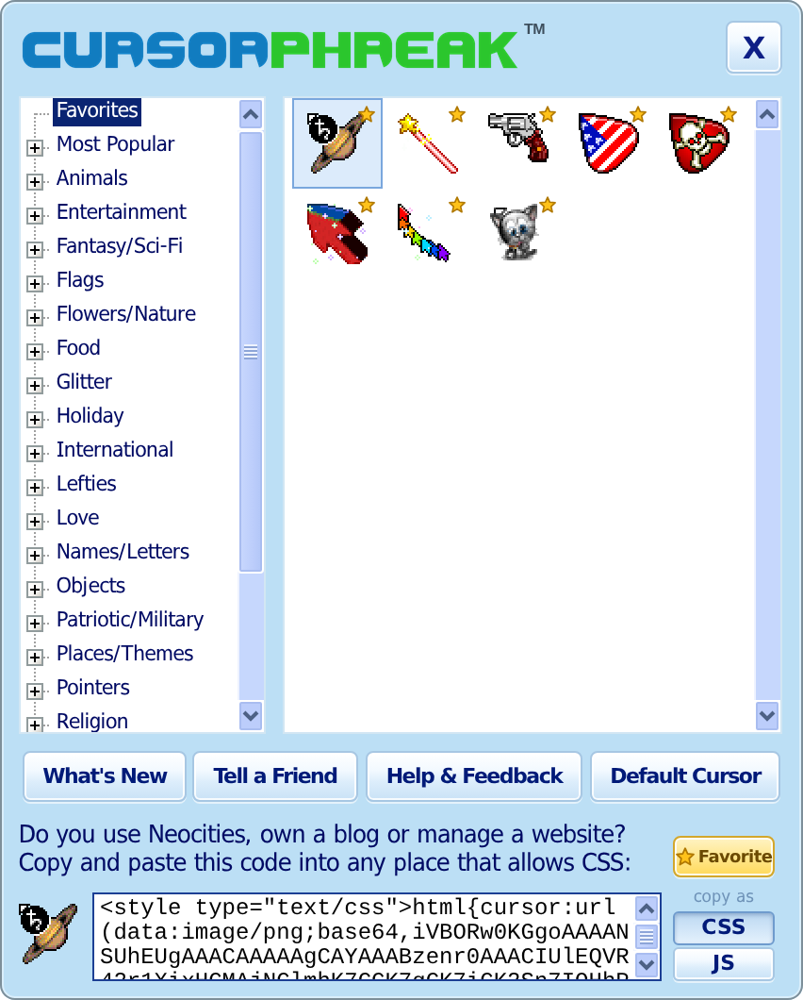
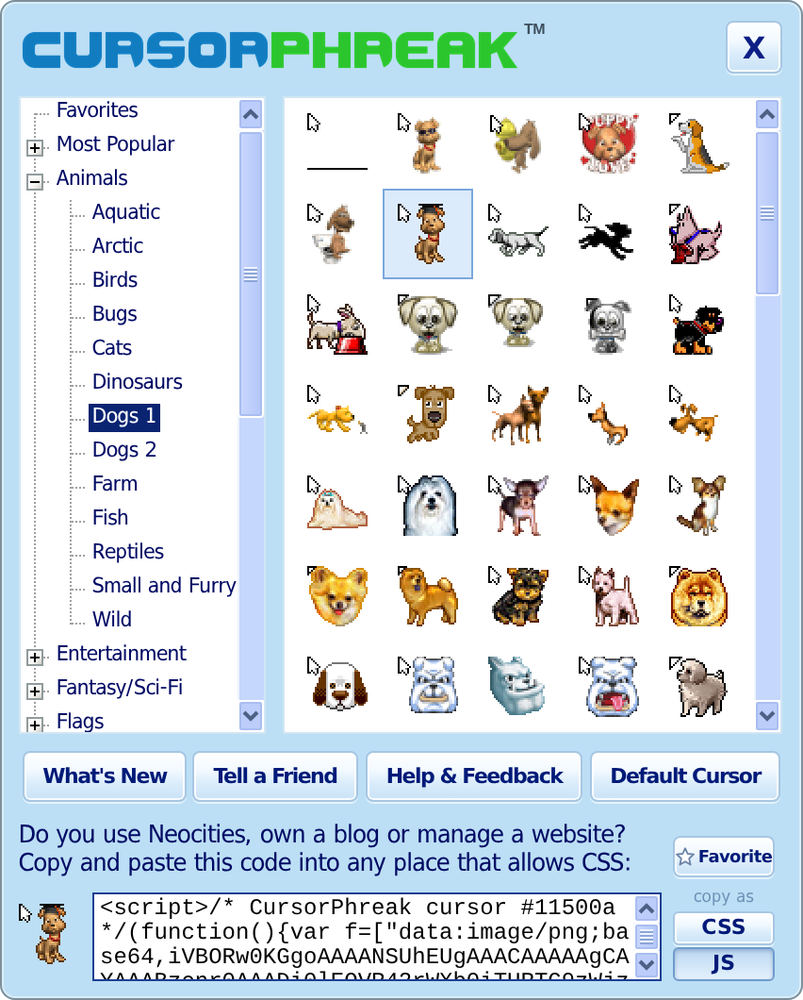

Vibe coded replica of a program I used to use back in the day. Confirmed working on Windows 11; the macOS, Linux and BSD builds haven't been tested on real machines yet. Original was sloppy C# but ChatGPT finished the project for me.

  

  
  &nbsp;
  

